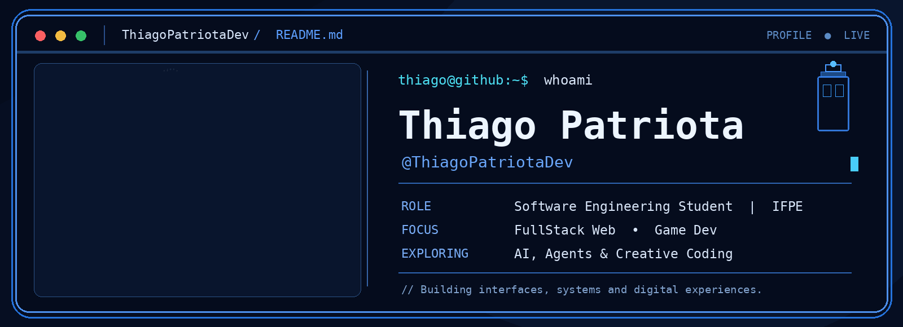
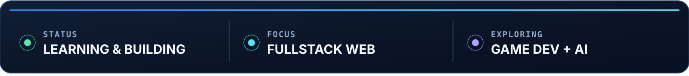

<!-- Thiago Patriota | github.com/ThiagoPatriotaDev -->
<!-- Identidade: Terminal Neon / Bento Grid. Assets locais: pasta assets/ -->

  

 

  SOFTWARE ENGINEERING  ·  WEB DEVELOPMENT  ·  CREATIVE TECHNOLOGY
  <h2>FullStack Web Developer em formação</h2>
  
Construindo interfaces, sistemas e experiências digitais com foco em <b>Web, tecnologia e criatividade.</b>

  

 

### `01 / SOBRE MIM`

Sou estudante de **Engenharia de Software no IFPE** e gosto de transformar ideias em interfaces e sistemas que sejam simples de usar, agradáveis de explorar e sólidos por dentro.

Minha jornada está concentrada em **desenvolvimento FullStack**, passando por frontend, backend, banco de dados e ferramentas do ciclo de software. Também venho experimentando **inteligência artificial, Agents e Skills**, além de explorar o universo do **Game Dev**.

 

### `02 / MINHA STACK`

<table width="100%" align="center">
  <tr>
    <td align="center" width="33%">
      <h3>Frontend</h3>
       
      
        
      
        HTML5 • CSS3 • JavaScript • React • Next.js
      
    </td>
    <td align="center" width="33%">
      <h3>Backend</h3>
       
      
        
      
        Node.js • Python • Java • C# • .NET
      
    </td>
    <td align="center" width="33%">
      <h3>Dados & Ferramentas</h3>
       
      
        
      
        PostgreSQL • Git • GitHub • VS Code
      
    </td>
  </tr>
</table>

 

### `03 / ATIVIDADE NO GITHUB`

  

 

### `04 / VAMOS CONVERSAR?`

  
Uma ideia, uma colaboração ou só uma boa conversa sobre tecnologia? Me encontra por aqui.

  
  
  
    
  <samp>Code. Build. Learn. Repeat.</samp>

